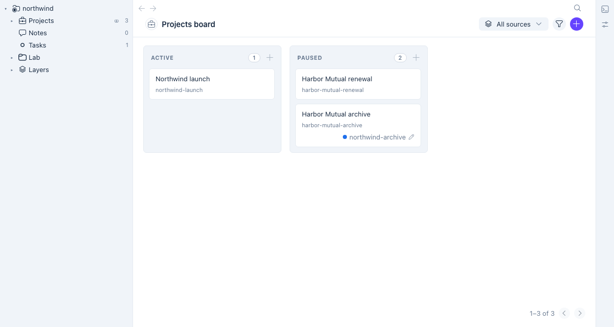

# @dreamteamer/web

`dt web` serves the dreamteamer UI in your browser, over a dreamteamer workspace on your own machine.
You get the same nav, lists, boards and record pages as the VS Code extension. Records change as they
change on disk, with no reload. Nothing leaves the machine: the server listens on loopback only.



> **Not released yet.** This README is written ahead of the code and is the contract the package is
> built to. It is `0.x`: any minor version may change the command line, and `UPDATING.md` says what to do.
> Apache-2.0. Issues: https://github.com/dreamteamer/dreamteamer-modules/issues

## quick start

You need Node 20 or newer, git, and a compiled dreamteamer workspace. If you don't have one yet:

```bash
mkdir northwind && cd northwind
npx dreamteamer init
npx dreamteamer compile
```

Then, in the workspace:

```bash
npm install --save-dev @dreamteamer/web
npx dt web
```

```text
✔ dreamteamer web at http://127.0.0.1:53817/sign-in/7Qx2…k9Fa
```

The first line on stdout is always the sign-in URL. Your browser opens it. The page that loads is the
workspace.

The package ships the built app inside its tarball. The first run needs no network, and nothing is
written into `node_modules`.

To try it without adding a dependency, run it through `npx -p`, which works for every subcommand below:

```bash
npx -p @dreamteamer/web dt-web .            # start
npx -p @dreamteamer/web dt-web . status     # the same as `npx dt web status`
```

Uninstall: `npm uninstall @dreamteamer/web`. `dt web` leaves no files behind in the workspace once it
has stopped.

## commands

| command | does |
|---|---|
| `npx dt web` | starts the server on a free loopback port, prints the sign-in URL, opens your browser |
| `npx dt web --no-open` | the same, but opens nothing. Only the URL is printed |
| `npx dt web --port 4870` | listens on 4870, or refuses to start if it is taken. `DT_WEB_PORT` does the same. The default is `0`, a free port |
| `npx dt web --idle 30` | stops after 30 minutes with no page connected. `0` never stops for idleness. The default is 30 |
| `npx dt web --owner-pid 4242` | stops within 5 seconds of process 4242 exiting |
| `npx dt web url` | prints a fresh sign-in URL for the running server |
| `npx dt web status` | `running at http://127.0.0.1:<port> · pid <n> · since <time>` and exit 0, or `not running` and exit 1. It writes nothing |
| `npx dt web stop` | stops the running server |

One server serves one workspace. `npx dt doctor` shows a `web` row saying whether a server is running.

For an agent session: the `serving-the-web-ui` skill, shipped in this package, says how a session starts
`dt web`, reads the first stdout line, and hands the URL to whatever shows it. `dt web` itself promises
only what is above: `--no-open`, `--owner-pid`, and the URL as the first line.

## what you see

- **The nav** on the left, built from the same model as the extension's tree: module folders, collections
  with their record counts, saved views, and a Layers folder for the workspaces under `git_modules/`. It
  follows the workspace's `.vscode/settings.json` (`dreamteamer.navGroups`, `navOrder`, `navHidden`,
  `layersFolder`).
- **The pages** are the extension's own: lists, boards, calendars, record pages, and the schema and
  activity pages.
- **Live updates.** A record written by `dt set`, by an agent or by a `git pull` appears within a second.
  So does a `dt compile` run while the server is up.
- **Light or dark** follows your system's setting.

Not drawn in the browser: the gestures that belong to the editor, such as New Module…, New Skill… and
running an editor command.

## security

### what it protects against, and what it does not

| | |
|---|---|
| **protects against** | web pages on other origins, including DNS names rebound to `127.0.0.1` (Host and Origin checks); a page on another site making your browser read or write here (`Sec-Fetch-Site: cross-site` is refused, and a write needs an `Origin` naming this server or a token); a hostile image, SVG or `.html` file a record points at running script as you (record files come from a second, sandboxed origin); other users on the machine reading your token (it is in your per-user runtime directory, mode `0600`) |
| **does not protect against** | **Another loopback server your browser visits.** Cookies are not port-scoped, so your browser sends this session to any server on `127.0.0.1`, whatever its port; a program serving one of those ports receives it and, not being a browser, can send any `Origin` it likes. **Another process running as you**: it can read your runtime directory, as it can read your files. **A browser extension** with access to `127.0.0.1`: the cookies API reads `HttpOnly` cookies. **Where the sign-in URL is written down** before it is used or expires: a session transcript, a desktop pane's logs, your shell history. **A module's app**, including one from a workspace under `git_modules/`: it runs in the page with your session, exactly as it does inside VS Code — install and read modules you trust (a sandboxed bridge for module apps is a separate change) |

Found a hole? See [SECURITY.md](../../SECURITY.md). Do not open a public issue.

### how it works

- **Loopback only.** The server binds `127.0.0.1` and has no `--host` option. There is no tunnel and no
  multi-user mode. To serve the API alone on another address, use `dt serve --host … --token …` from
  `@dreamteamer/http`.
- **Host and Origin.** A request's `Host` must be `127.0.0.1:<port>`, `localhost:<port>` or
  `[::1]:<port>`, with this server's port. An `Origin`, when sent, must be `http://` plus one of those.
  Anything else gets `403`.
- **A token per start, and a single-use sign-in.** Each start mints a new random token. It lives as long
  as the server and is kept in your per-user runtime directory (on Linux `$XDG_RUNTIME_DIR/dreamteamer-web/`,
  on macOS `~/Library/Application Support/dreamteamer/web/runtime/`): the directory is mode `0700`, the
  file `0600`, and nothing goes into the workspace, so it never lands in a synced folder. The printed URL
  carries a **single-use sign-in code**, not the token. The first visit exchanges it for a session cookie
  (`HttpOnly; SameSite=Strict; Path=/`) and redirects to `/`. A used code is refused, a code not used within
  10 minutes expires, and `dt web url` mints a new one. An agent session should mint the URL right before
  opening it and never write it into a chat.
- **Cookies are not port-scoped.** Your browser sends this cookie to every server on `127.0.0.1`, whatever
  the port (see the table above). So a write authenticated by the cookie must also carry an `Origin`, or
  `Sec-Fetch-Site: same-origin`, naming this server; a write without either needs `Authorization: Bearer
  <token>`. Every modern browser sends one or the other. Any request, read or write, marked
  `Sec-Fetch-Site: cross-site` is refused.
- **Headers.** Every response carries `Referrer-Policy: no-referrer` and `X-Content-Type-Options: nosniff`,
  and no `X-Powered-By`. The app page carries exactly
  `Content-Security-Policy: default-src 'self'; script-src 'self' 'nonce-<new per response>'; style-src 'self' 'unsafe-inline'; img-src 'self' <files origin>; connect-src 'self'; frame-ancestors 'none'; base-uri 'none'; form-action 'none'`.
  The only inline script is the boot script, which carries that nonce. Scripts otherwise load only from
  the app's origin, which includes the workspace's module apps under `/ui-modules/`.
- **Links in record text.** A link in a markdown field is drawn as a link only for `http:`, `https:` and
  `mailto:` addresses and the app's own routes; anything else, such as `javascript:`, is drawn as text.
- **Revisions are checked.** A commit named in a request (`?hash=` on a record's history, `hash` on a
  revert) must be `HEAD` or 4 to 40 hexadecimal characters; anything else is `400` and never reaches git.
- **Record files on a second origin.** Images, SVGs and `.html` pages a record points at are served from a
  second loopback port. That port has no cookie and no API, and the address of each file carries its own
  per-start key. Every response there carries `Content-Security-Policy: sandbox` (scripts off, unique
  origin), and SVG and HTML are sent with `Content-Disposition: attachment` unless they are shown inside a
  sandboxed frame. A hostile file can therefore never reach your records.
- **Writes go through the engine.** A record edited in the page is validated and written exactly as
  `dt set` writes it. A refusal shows the engine's own sentence beside the control.

### served

- **The app origin** serves the UI's built files, the workspace's module apps (`.dreamteamer/ui/`), and the
  protocol at `/api/` over the workspace's records.
- **The files origin** serves files inside the folders that declared variables render to (for example
  `${env:FILES_FOLDER}/…` on a record), and `.html` pages inside the workspace that a record names. A path
  with `..`, an absolute path, or a link pointing out of its root is refused.
- **Listing a record's folder** (the carousel) answers only for a folder inside those declared roots, and
  names its files relative to the root, never by absolute path.
- **Importing a file as a record** reads it only from inside those declared roots.

Nothing else is served: no other file on disk, no `.env` value, and no credential.

## the editor marker

`npx dt status` prints an `editor:` line from `.dreamteamer/editor.json`, which an editor writes when it
opens the workspace. Whether `dt web` should show there, and how, is **an open question**. Today the
engine reads only that one file, so showing a second editor means either sharing the file with the VS Code
extension or an engine change. The answer goes into `UPDATING.md`. Until then, `npx dt web status` is the
way to ask whether a server is running.

## versions

| @dreamteamer/web | @dreamteamer/protocol | @dreamteamer/ui | engine (`dreamteamer`) |
|---|---|---|---|
| 0.1.x | ^0.1.0 | ^0.1.0 | `>=0.43.0`, tested on 0.43 and 0.44 |

The app is `@dreamteamer/ui`'s browser page (`dist/app/` in that package), the same UI the VS Code
extension mounts, built when `@dreamteamer/ui` is published and served as it is. It reaches the server
through the UI's HTTP transport, so this package carries no app and no host emulation of its own. Known
advisories in dependencies, and whether they reach a request, are listed in `SECURITY.md`.

## limits

- One workspace per server, and one person per machine.
- The nav reads the workspace's `.vscode/settings.json` only. A setting kept in your VS Code user settings
  is not seen.
- Browsers: current Chrome, Edge, Firefox and Safari. Live updates use server-sent events, which Safari
  supports.
- Linux: live updates need Node 20 or newer (recursive file watching). A workspace with very many files can
  hit the inotify watch limit (`fs.inotify.max_user_watches`).
- macOS and Linux only. Windows is untested.

## troubleshooting

- **"Sign in with the URL `dt web` printed"**: you opened the bare address, or reused a sign-in URL. Run
  `npx dt web url` and open the new one.
- **`403`**: the address is not one this server answers. Use `127.0.0.1`, `localhost` or `[::1]` with the
  printed port.
- **"port 4870 is in use"**: drop `--port` (or `DT_WEB_PORT`) to take a free port.
- **The page doesn't change when a record does**: check that the server is still running (`npx dt web
  status`). On Linux, check the Node version and the inotify limit.
- **"the app is missing"**: the installed package is incomplete. Reinstall it.
